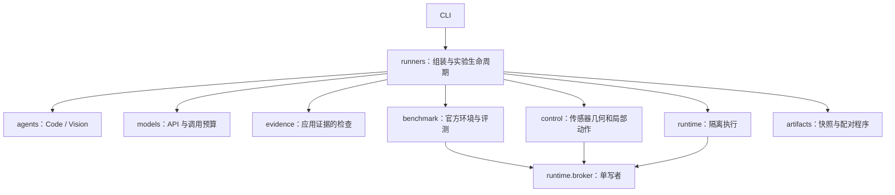

# NavCode 代码结构

## 按职责组织

```text
navcode/
├── agents/                 # Code / Vision 角色、协议和提示词
│   ├── code.py             # 策略合成、修复与 revision
│   ├── vision.py           # 图像调查、历史检索、裁剪
│   ├── protocol.py         # JSON 与 Python Policy 协议检查
│   └── prompts.py          # 角色提示词
├── prompts/                # 可审查的角色提示词资源
│   ├── roles/              # Skills 模式的短角色提示
│   ├── legacy/             # 旧配置对照，文本保持一致
│   └── experimental/       # 可消融的方向绑定提示
├── skills/                 # 导航过程指导与角色授权目录
│   ├── registry.py         # 只读本次运行的冻结技能包
│   ├── catalog.json        # 名称、描述、角色与入口
│   └── */SKILL.md          # 策略编写、路线、受阻、修复与验证
├── models/api.py           # 模型传输、凭据读取、调用预算与 usage
├── control/                # 合法传感器上的几何与局部动作
│   ├── geometry.py         # 深度射线和地面估计
│   ├── rgbd.py             # 候选生成、逐步检查与有界恢复
│   └── route_grounding.py  # 图像路线方向到当前候选的绑定
├── evidence/gates.py       # 当前帧、阶段顺序与时序证据检查
├── runtime/                # 执行边界
│   ├── broker.py           # 唯一动作写入者与 op_id 幂等性
│   ├── sandbox.py          # bubblewrap 与宿主 RPC
│   └── policy_worker.py    # 沙箱内独立 Python Worker
├── benchmark/vlnce.py      # 官方 Habitat / R2R / RxR 接入与原生评测
├── artifacts/              # 可复现实验材料
│   ├── initial_policy.py   # 验证并重用运动前的初始程序
│   └── provenance.py       # 递归源码快照、hash 与批次版本冻结
├── runners/                # 组装各层、预算、轨迹和实验生命周期
│   ├── development.py      # RGB 开发运行器
│   └── grounded.py         # RGB-D / 阶段合同实验运行器
├── paths.py                # 项目和包路径
└── __main__.py             # 统一 CLI
```

`grounded.py`、`develop.py` 和 `model_api.py` 在包根目录仅作为旧 CLI 的兼容入口；实现位于子包。`python -m navcode.benchmark` 也继续可用。

## 依赖与权限边界



图中的 `control → broker` 与 `sandbox → broker` 通过 runner 注入的动作回调连接。控制器不直接持有 Habitat 环境，策略 Worker 只通过 RPC 请求动作。

- Agent 处理任务、代码与合法视觉证据，不导入 benchmark 或读取 GT。
- Controller 接收 RGB-D、标定和动作回执；不查询位姿、navmesh 或目标距离。
- Benchmark 隐藏环境元数据，原生指标只在 episode 结束后由评测侧读取。
- Runner 管理预算与证据应用，不把 resolved config 传给模型。
- API 适配器持有模型凭据；Worker 不挂载宿主目录、凭据或网络。
- Artifact 快照递归覆盖 Python 子包、Markdown 提示词/技能及 JSON 目录，使用相对路径保留层次；批次检查也检测文件新增与删除及指导内容改变。

未来增加新的 Agent、控制技能和运行配置，应放入所属子包；根目录入口保持薄层。不要把新的运动实现或提示词继续堆入 runner。

## 运行

```bash
source scripts/navcode_env.sh
.venv/bin/python -m navcode --help
.venv/bin/python -m navcode smoke --suite r2r --output experiments/new_smoke
.venv/bin/python -m navcode navigate --suite r2r --episode-id 3586 --output experiments/new_run
```

`navigate` 会调用收费模型；`smoke` 只验证模拟器链路。`--route-grounding`、`--route-memory` 和 `--skills` 目前是开发实验开关，尚无稳定提升证据。技能组织和读取机制见 [NAVIGATION_SKILLS.md](NAVIGATION_SKILLS.md)。

## 本次迁移验证

重构前代码保存在 `experiments/package_refactor_20261031/before/`。主要 Agent、控制器、Broker、证据检查和模型适配方法的 AST 对比均一致，Worker 文件逐字节一致，结果见 `semantic_checks.json`。源码归档改为递归实现并增加独立测试。完整测试69项通过；实际模拟器诊断与模型实验结果独立记录，不能将目录重构写成导航性能提升。

之后的 Skills 迭代将旧提示词转为资源文件，并验证旧文本逐项一致（`prompt_resource_checks.json`）。截至本轮收尾，源码与指导共50个资源：34个 Python、15个 Markdown 和1个 JSON；完整测试76项通过，见 `experiments/tests_skills_v9_final.txt`。
